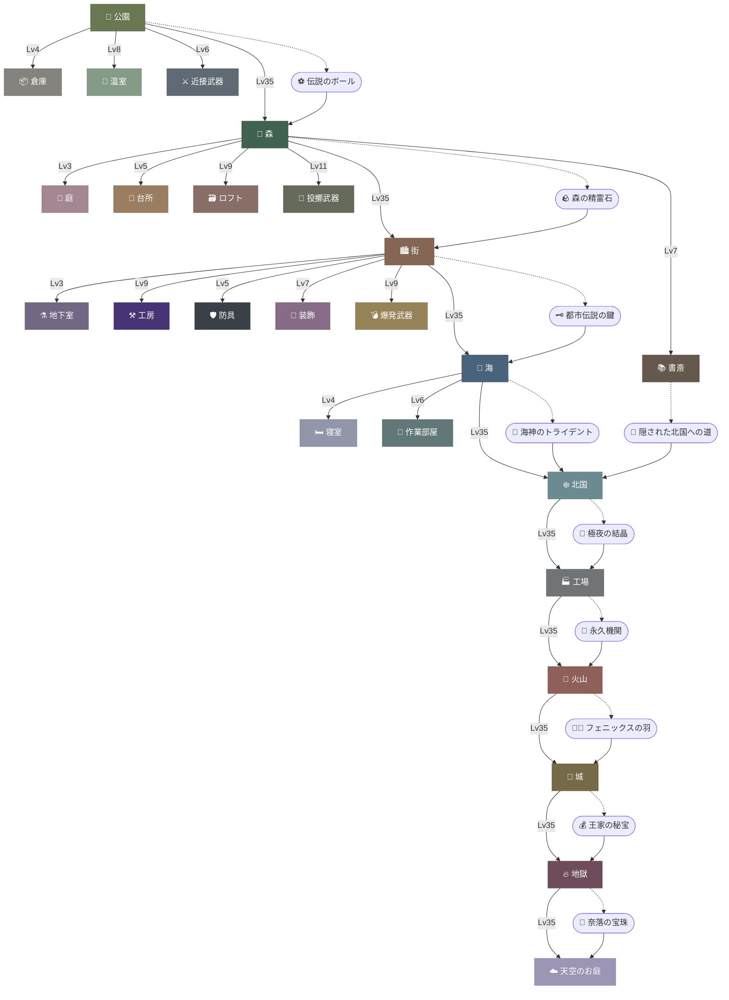

# 進行チャート

カテゴリの解放条件をつないだ図。実線はカテゴリのレベル・条件アイテム、点線は条件アイテムが手に入る場所。ノードをクリックするとそのページへ移る。想定プレイ時間は 100日。

## 解放の順番

| カテゴリ | 解放条件 | 条件アイテムの入手先 |
| --- | --- | --- |
| [公園](/ja/category/park) | 最初から |  |
| [森](/ja/category/forest) | [公園](/ja/category/park) Lv35以上、[伝説のボール](/ja/item/legendary-ball) ×1 | [伝説のボール](/ja/item/legendary-ball) ← [夕暮れの散歩道](/ja/action/twilight-promenade) |
| [街](/ja/category/town) | [森](/ja/category/forest) Lv35以上、[森の精霊石](/ja/item/forest-spirit-stone) ×1 | [森の精霊石](/ja/item/forest-spirit-stone) ← [倒木あさり](/ja/action/scavenge-fallen-tree) |
| [海](/ja/category/sea) | [街](/ja/category/town) Lv35以上、[都市伝説の鍵](/ja/item/urban-legend-key) ×1 | [都市伝説の鍵](/ja/item/urban-legend-key) ← [盗賊](/ja/action/thief) |
| [北国](/ja/category/northland) | [海](/ja/category/sea) Lv35以上、[海神のトライデント](/ja/item/sea-god-trident) ×1、[隠された北国への道](/ja/item/hidden-path-to-northland) ×1 | [海神のトライデント](/ja/item/sea-god-trident) ← [沈没船探査](/ja/action/shipwreck-survey)、[隠された北国への道](/ja/item/hidden-path-to-northland) ← [古びた地図](/ja/action/read-map) |
| [工場](/ja/category/factory) | [北国](/ja/category/northland) Lv35以上、[極夜の結晶](/ja/item/polar-night-crystal) ×1 | [極夜の結晶](/ja/item/polar-night-crystal) ← [凍った湖畔](/ja/action/frozen-lakeside) |
| [火山](/ja/category/volcano) | [工場](/ja/category/factory) Lv35以上、[永久機関](/ja/item/perpetual-motion-machine) ×1 | [永久機関](/ja/item/perpetual-motion-machine) ← [マッドサイエンティスト](/ja/action/mad-scientist) |
| [城](/ja/category/castle) | [火山](/ja/category/volcano) Lv35以上、[フェニックスの羽](/ja/item/phoenix-feather) ×1 | [フェニックスの羽](/ja/item/phoenix-feather) ← [火口の底](/ja/action/crater-floor) |
| [地獄](/ja/category/hell) | [城](/ja/category/castle) Lv35以上、[王家の秘宝](/ja/item/royal-treasure) ×1 | [王家の秘宝](/ja/item/royal-treasure) ← [ネクロマンサー](/ja/action/necromancer) |
| [天空のお庭](/ja/category/sky-garden) | [地獄](/ja/category/hell) Lv35以上、[奈落の宝珠](/ja/item/abyss-orb) ×1 | [奈落の宝珠](/ja/item/abyss-orb) ← [骸骨拾い](/ja/action/bone-gathering) |
| [倉庫](/ja/category/warehouse) | [公園](/ja/category/park) Lv4以上 |  |
| [温室](/ja/category/greenhouse) | [公園](/ja/category/park) Lv8以上 |  |
| [庭](/ja/category/garden) | [森](/ja/category/forest) Lv3以上 |  |
| [台所](/ja/category/kitchen) | [森](/ja/category/forest) Lv5以上 |  |
| [書斎](/ja/category/study) | [森](/ja/category/forest) Lv7以上 |  |
| [ロフト](/ja/category/loft) | [森](/ja/category/forest) Lv9以上 |  |
| [地下室](/ja/category/basement) | [街](/ja/category/town) Lv3以上 |  |
| [工房](/ja/category/atelier) | [街](/ja/category/town) Lv9以上 |  |
| [寝室](/ja/category/bedroom) | [海](/ja/category/sea) Lv4以上 |  |
| [作業部屋](/ja/category/workshop) | [海](/ja/category/sea) Lv6以上 |  |
| [近接武器](/ja/category/melee-weapon) | [公園](/ja/category/park) Lv6以上 |  |
| [投擲武器](/ja/category/throwing-weapon) | [森](/ja/category/forest) Lv11以上 |  |
| [防具](/ja/category/armor) | [街](/ja/category/town) Lv5以上 |  |
| [装飾](/ja/category/accessory) | [街](/ja/category/town) Lv7以上 |  |
| [爆発武器](/ja/category/explosive-weapon) | [街](/ja/category/town) Lv9以上 |  |

## ゲームクリア

すべての numeric カテゴリ（レベルのあるカテゴリ）が Lv50 に達すると [クリア](/ja/event/complete) が発生する。
