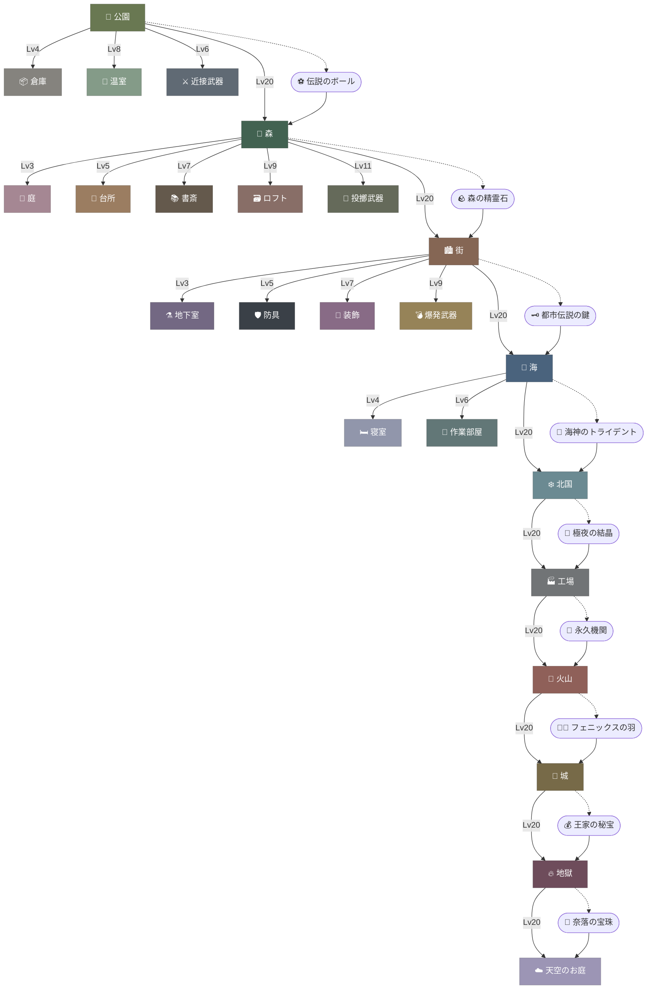

# 進行チャート

カテゴリの解放条件をつないだ図。実線はカテゴリのレベル・条件アイテム、点線は条件アイテムが手に入る場所。ノードをクリックするとそのページへ移る。想定プレイ時間は 100日。

## 解放の順番

| カテゴリ | 解放条件 | 条件アイテムの入手先 |
| --- | --- | --- |
| [🌳公園](/ja/category/park) | 最初から |  |
| [🌲森](/ja/category/forest) | [🌳公園](/ja/category/park) Lv20以上 [⚽伝説のボール](/ja/item/legendary-ball) ×1 | [⚽伝説のボール](/ja/item/legendary-ball) ← [🌇夕暮れの散歩道](/ja/action/twilight-promenade) |
| [🏙️街](/ja/category/town) | [🌲森](/ja/category/forest) Lv20以上 [🪨森の精霊石](/ja/item/forest-spirit-stone) ×1 | [🪨森の精霊石](/ja/item/forest-spirit-stone) ← [🪵倒木あさり](/ja/action/scavenge-fallen-tree) |
| [🌊海](/ja/category/sea) | [🏙️街](/ja/category/town) Lv20以上 [🗝️都市伝説の鍵](/ja/item/urban-legend-key) ×1 | [🗝️都市伝説の鍵](/ja/item/urban-legend-key) ← [🥷盗賊](/ja/action/thief) |
| [❄️北国](/ja/category/northland) | [🌊海](/ja/category/sea) Lv20以上 [🔱海神のトライデント](/ja/item/sea-god-trident) ×1 | [🔱海神のトライデント](/ja/item/sea-god-trident) ← [🚢沈没船探査](/ja/action/shipwreck-survey) |
| [🏭工場](/ja/category/factory) | [❄️北国](/ja/category/northland) Lv20以上 [🌌極夜の結晶](/ja/item/polar-night-crystal) ×1 | [🌌極夜の結晶](/ja/item/polar-night-crystal) ← [🧊凍った湖畔](/ja/action/frozen-lakeside) |
| [🌋火山](/ja/category/volcano) | [🏭工場](/ja/category/factory) Lv20以上 [🔄永久機関](/ja/item/perpetual-motion-machine) ×1 | [🔄永久機関](/ja/item/perpetual-motion-machine) ← [🧪マッドサイエンティスト](/ja/action/mad-scientist) |
| [🏰城](/ja/category/castle) | [🌋火山](/ja/category/volcano) Lv20以上 [🐦‍🔥フェニックスの羽](/ja/item/phoenix-feather) ×1 | [🐦‍🔥フェニックスの羽](/ja/item/phoenix-feather) ← [🌋火口の底](/ja/action/crater-floor) |
| [🔥地獄](/ja/category/hell) | [🏰城](/ja/category/castle) Lv20以上 [💰王家の秘宝](/ja/item/royal-treasure) ×1 | [💰王家の秘宝](/ja/item/royal-treasure) ← [💀ネクロマンサー](/ja/action/necromancer) |
| [☁️天空のお庭](/ja/category/sky-garden) | [🔥地獄](/ja/category/hell) Lv20以上 [🔮奈落の宝珠](/ja/item/abyss-orb) ×1 | [🔮奈落の宝珠](/ja/item/abyss-orb) ← [💀骸骨拾い](/ja/action/bone-gathering) |
| [📦倉庫](/ja/category/warehouse) | [🌳公園](/ja/category/park) Lv4以上 |  |
| [🌱温室](/ja/category/greenhouse) | [🌳公園](/ja/category/park) Lv8以上 |  |
| [🐾庭](/ja/category/garden) | [🌲森](/ja/category/forest) Lv3以上 |  |
| [🍳台所](/ja/category/kitchen) | [🌲森](/ja/category/forest) Lv5以上 |  |
| [📚書斎](/ja/category/study) | [🌲森](/ja/category/forest) Lv7以上 |  |
| [🗃️ロフト](/ja/category/loft) | [🌲森](/ja/category/forest) Lv9以上 |  |
| [⚗️地下室](/ja/category/basement) | [🏙️街](/ja/category/town) Lv3以上 |  |
| [🛏️寝室](/ja/category/bedroom) | [🌊海](/ja/category/sea) Lv4以上 |  |
| [🔧作業部屋](/ja/category/workshop) | [🌊海](/ja/category/sea) Lv6以上 |  |
| [⚔️近接武器](/ja/category/melee-weapon) | [🌳公園](/ja/category/park) Lv6以上 |  |
| [🎯投擲武器](/ja/category/throwing-weapon) | [🌲森](/ja/category/forest) Lv11以上 |  |
| [🛡️防具](/ja/category/armor) | [🏙️街](/ja/category/town) Lv5以上 |  |
| [💍装飾](/ja/category/accessory) | [🏙️街](/ja/category/town) Lv7以上 |  |
| [💣爆発武器](/ja/category/explosive-weapon) | [🏙️街](/ja/category/town) Lv9以上 |  |

## ゲームクリア

すべての numeric カテゴリ（レベルのあるカテゴリ）が Lv50 に達すると [🎉クリア](/ja/event/complete) が発生する。
